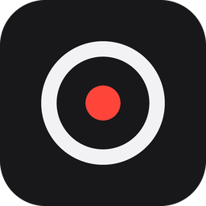
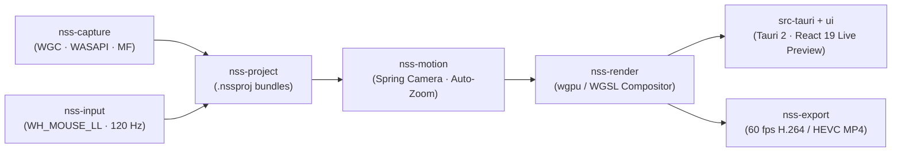

<div align="center">



# notscreenstudio for Windows

**A free, 100% offline screen recorder and studio editor for Windows — in the style of Screen Studio.**

Record a display, window, or region, then polish it with auto-zoom on clicks, critically-damped cursor smoothing, motion blur, click ripples, styled backgrounds, rounded corners, soft shadows, and a webcam bubble — exported straight to 60 fps MP4.

[](https://github.com/elementaryrock/notscreenstudio-win/releases/latest)
[](https://github.com/elementaryrock/notscreenstudio-win/actions/workflows/ci.yml)
[](https://github.com/elementaryrock/notscreenstudio-win/actions/workflows/release.yml)
[](https://github.com/elementaryrock/notscreenstudio-win/releases/latest)
[](LICENSE)

[Download Latest Release](https://github.com/elementaryrock/notscreenstudio-win/releases/latest) · [Features](#features) · [Architecture](#architecture) · [Build from Source](#build-from-source) · [Contributing](CONTRIBUTING.md)

</div>

---

> Ported to Windows (**Rust + Tauri 2 + wgpu/WGSL + React 19**) and maintained by **[elementaryrock (Maanas MS)](https://github.com/elementaryrock)** from the original macOS project [dotslashsimran/notscreenstudio](https://github.com/dotslashsimran/notscreenstudio) (MIT).

## Download & Quick Start

Grab the latest build from **[GitHub Releases](https://github.com/elementaryrock/notscreenstudio-win/releases/latest)**:

| Package | Best For | Notes |
| --- | --- | --- |
| **`notscreenstudio.exe`** | Portable / zero-install | Double-click to run directly — the entire UI is embedded inside the EXE |
| **`*-setup.exe`** | Standard install | NSIS Windows installer with Start Menu & uninstaller entries |
| **`*.msi`** | Enterprise / managed install | Native Windows Installer package |
| **`SHA256SUMS.txt`** | Verification | SHA-256 checksums for every release binary |

### Setup (2 steps)

1. **Install FFmpeg** (used for audio/video recording and MP4 export — tested with FFmpeg **8.1.1**):
   ```powershell
   winget install Gyan.FFmpeg
   ```
   *(Alternatively, place `ffmpeg.exe` and `ffprobe.exe` next to `notscreenstudio.exe` — no `PATH` change needed.)*
2. **Run `notscreenstudio.exe`** directly (or install via the `.exe` / `.msi` installer).

> [!TIP]
> If Windows SmartScreen prompts when launching an unsigned open-source binary, click **More info → Run anyway**. No internet connection or account is ever required.

### System Requirements

- **OS:** Windows 10 (2004 / build 19041+) or Windows 11 (x64) — Windows 11 recommended for borderless capture
- **GPU:** DirectX 12 / Direct3D 11 capable GPU (falls back cleanly to CPU preview when needed)
- **WebView2:** Microsoft Edge WebView2 Runtime (preinstalled on Windows 11 and modern Windows 10)
- **FFmpeg:** `ffmpeg.exe` and `ffprobe.exe` on `PATH`, via WinGet/Chocolatey/Scoop, or placed beside `notscreenstudio.exe`

---

## Features

| Area | What You Get |
| --- | --- |
| **Native Windows Capture** | Windows Graphics Capture (`Direct3D11CaptureFramePool`) with per-monitor DXGI adapter matching for hybrid-GPU & dual-monitor setups, Per-Monitor DPI v2 physical resolution, 60 Hz CFR pacing, warm countdown gate, gapless pause/resume, WASAPI mic + system audio loopback, Media Foundation webcam capture, and own-window exclusion (`WDA_EXCLUDEFROMCAPTURE`). |
| **120 Hz Cursor & Clicks** | Low-level mouse hook (`WH_MOUSE_LL`) + 120 Hz high-resolution sampler aligned to the shared recording clock, mixed-DPI & negative multi-monitor coordinates, and 30 Hz cursor shape detection (`IDC_*` + SHA-256 / 16x16 bitmap fingerprinting). |
| **Auto-Zoom & Spring Motion** | Automatic click clustering into non-overlapping zoom blocks, critically-damped spring camera & cursor smoothing, click press squish, animated click ripples, idle cursor fade, and a zero-edge-gap viewport clamp. |
| **Single-Pass GPU Compositor** | Custom `wgpu`/WGSL pipeline with OKLab mesh gradients, solid colors, linear gradients, Windows wallpapers, separable linear-light Gaussian background blur, 18-shape mipmapped vector cursor atlas, anti-aliased rounded corners, analytical soft shadows, and shaped webcam bubble (`circle`, `square`, `tall`, `wide`) with shrink-on-zoom. |
| **Frame-Exact Preview & Export** | Live editor preview and offline MP4 export share the exact same `SpringMotionModel` + `AssetFrameSource` + `Renderer` pipeline. Export **1080p** or **4K** at **30 / 60 fps** in **`16:9`**, **`1:1`**, or **`9:16`** with **H.264 / HEVC**, 48 kHz stereo AAC audio mix, atomic finalize, and instant cancellation. |
| **Windows Studio Shell** | System tray icon with live idle/recording/paused visuals and elapsed timer tooltip, global hotkeys with conflict detection, capture-excluded HUD overlays, OneDrive-aware Videos library (`SHGetKnownFolderPath`), Recycle Bin deletion, debounced autosave with `.bak` recovery, and single-instance window activation. |

### Default Global Shortcuts

| Shortcut | Action |
| --- | --- |
| `Ctrl+Shift+R` | Start / Stop recording *(customizable in Settings)* |
| `Ctrl+Shift+P` | Pause / Resume recording *(customizable in Settings)* |

---

## Privacy Guarantee

> [!IMPORTANT]
> **Nothing leaves your machine.** Zero accounts, zero analytics, zero telemetry, zero update pings, and zero cloud uploads.
>
> Both privacy and memory-safety boundaries are enforced automatically on every push in [CI](.github/workflows/ci.yml):
> - The build **fails** if any network stack crate (`reqwest`, `hyper`, `curl`, `sentry`, etc.) is added to workspace manifests.
> - `unsafe` Rust code is strictly confined to the four audited Windows FFI modules (`windows_trash.rs`, `nss-capture/src/win/`, `nss-input/src/win/`, `src-tauri/src/win_shell.rs`); every other crate uses `#![forbid(unsafe_code)]` or `#![deny(unsafe_code)]`.

---

## Architecture



<details>
<summary><strong>Workspace layout (9 crates + React UI)</strong></summary>

| Path | Responsibility |
| --- | --- |
| `crates/nss-core` | Platform-neutral models, serde wire format, contracts |
| `crates/nss-motion` | Spring camera, cursor physics, click ripples, auto-zoom planner |
| `crates/nss-project` | `.nssproj` bundles, atomic save/backup, Recycle Bin |
| `crates/nss-capture` | Windows Graphics Capture, WASAPI loopback/mic, Media Foundation webcam |
| `crates/nss-input` | `WH_MOUSE_LL` mouse hook, 120 Hz cursor sampler, cursor shape detector |
| `crates/nss-render` | `wgpu`/WGSL single-pass compositor, Gaussian blur, vector cursor atlas |
| `crates/nss-export` | 60 fps MP4 exporter, FFmpeg muxing, at-or-before frame decoding |
| `src-tauri` | Tauri 2 shell, system tray, capture-excluded HUD overlays, hotkeys, preview IPC |
| `ui` | React 19 + strict TypeScript Home, Studio Editor, Timeline, Inspector & HUDs |
| `scripts` | PowerShell dev, CI test gate, standalone build, and GitHub Release automation |

</details>

---

## Build from Source

### Developer Prerequisites

- **Rust 1.86+** with the MSVC toolchain (pinned automatically via `rust-toolchain.toml`)
- **Visual Studio 2022 Build Tools** (Desktop development with C++ workload + Windows 10/11 SDK)
- **Node.js 22+** for the React frontend (`ui/`)
- **FFmpeg** on `PATH` (for media capture/export tests)

### Common Commands

Run from PowerShell at the repository root:

```powershell
# Hot-reload Tauri + Vite development loop
./scripts/dev.ps1

# Full local CI gate (fmt, clippy -D warnings, Rust + GPU + export tests, UI typecheck/test/build, smoke test)
./scripts/test.ps1

# Build standalone portable notscreenstudio.exe (embedded UI) + MSI & NSIS installers into dist-release/
./scripts/build.ps1

# Full test + standalone live EXE verification + GitHub Release publish
./scripts/release.ps1
```

Headless self-check (works without a GUI session):

```powershell
cargo run -p notscreenstudio-win-app --bin notscreenstudio -- --smoke-test
```

Pushing a version tag (`git tag v0.1.0 && git push origin v0.1.0`) also runs [`.github/workflows/release.yml`](.github/workflows/release.yml) automatically to build and attach `notscreenstudio.exe`, Windows installers, and `SHA256SUMS.txt` to GitHub Releases.

---

## Platform Notes & Known Limitations

<details>
<summary><strong>Windows-specific capture details</strong></summary>

- **Yellow capture border:** Windows Graphics Capture draws a yellow border around captured windows/displays by default. On Windows 11 (22000+), you can request borderless capture once in **Settings**; on Windows 10 or if declined, Windows keeps the border visible.
- **Elevated apps & UAC secure desktop:** A standard (non-elevated) `WH_MOUSE_LL` hook cannot observe mouse input over administrator-elevated windows or the UAC desktop; the recorded cursor holds smoothly until focus returns to normal windows.
- **Custom app cursor shapes:** Identified via `LoadCursorW(IDC_*)` handles and 16x16 / SHA-256 bitmap fingerprints, falling back to the standard arrow for unrecognized custom cursors.
- **Single-monitor area capture:** Area capture crops out of a single display capture; dragging an area across two monitors clamps cleanly to the starting display.
- **SDR output:** Live previews and MP4 exports render in 8-bit sRGB / SDR.

</details>

---

## License & Attribution

Licensed under the **[MIT License](LICENSE)**.

- **Original macOS version:** Copyright © 2026 [dotslashsimran](https://github.com/dotslashsimran/notscreenstudio)
- **Windows port & modifications:** Copyright © 2026 [elementaryrock](https://github.com/elementaryrock) (Maanas MS)
